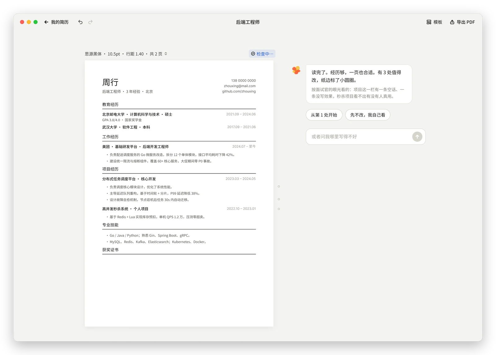
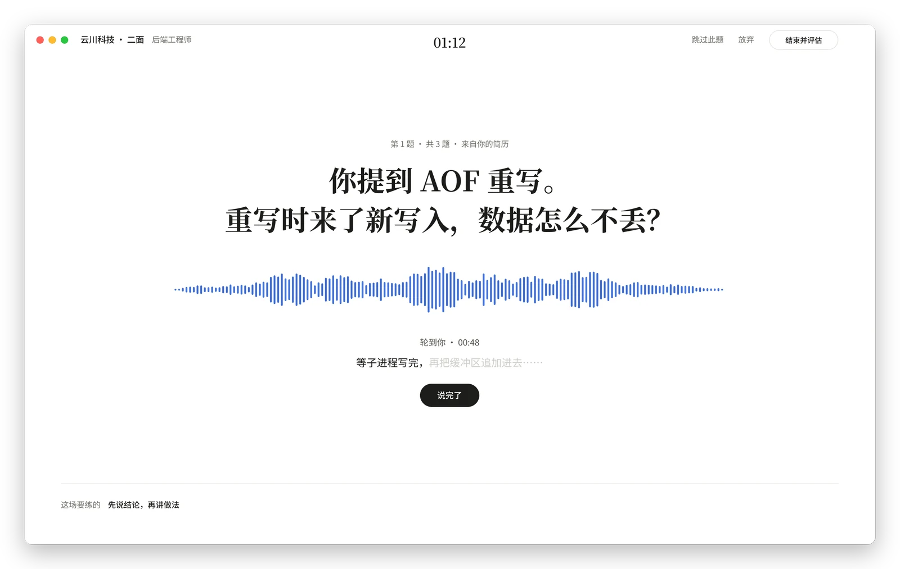
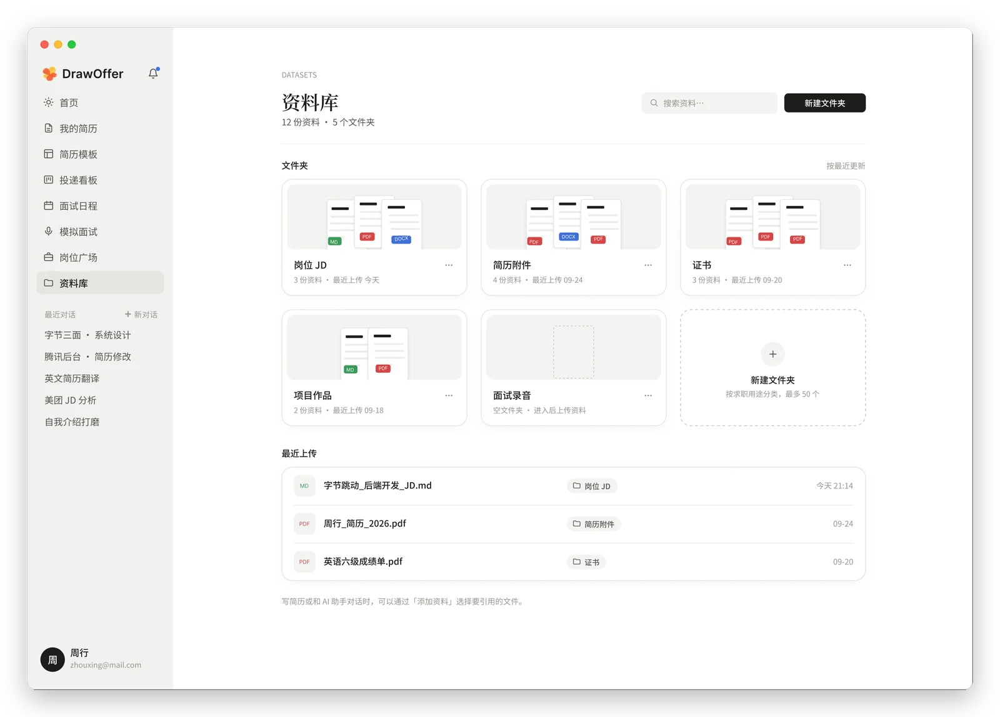

<h1>DrawOffer</h1>

<b>The job-search partner that knows your story</b>

Resume edits, application tracking, interview reviews and mock follow-up questions — all based on your real experience, not a generic template.

<a href="https://www.drawoffer.com">Website</a> ·
<a href="https://www.drawoffer.com/assistant">Use online</a> ·
<a href="https://github.com/DrawOffer/drawoffer/issues">Issues</a> ·
<a href="README.md">简体中文</a>

DrawOffer is an AI job-search partner for students and job seekers. It keeps your resumes, applications, practice sessions and every real interview in a **long-term memory**: when it edits your resume it knows the role you are applying for, when it writes questions it knows where you got stuck last time, and each interview picks up where the last one left off.

This repository hosts the **native macOS and Windows desktop clients**. They share the same account and data with the web app and the WeChat mini program. The product is currently in Chinese.

**[Start free →](https://www.drawoffer.com/assistant)**

<table>
<tr>
<td width="50%" valign="top"><b>No need to start over</b> Tonight continues from last night, the next interview from this one. No re-pasting your resume or re-telling the last interview.</td>
<td width="50%" valign="top"><b>One resume, one role</b> Rewrite every section against the job description using only what you actually did. You approve every change.</td>
</tr>
<tr>
<td width="50%" valign="top"><b>Written vs. answered</b> What your resume says is your claim; what you answer in interviews is what counts. If it has never been asked, DrawOffer says it does not know yet.</td>
<td width="50%" valign="top"><b>You decide</b> You review every edit. Every memory shows its source and can be edited or deleted.</td>
</tr>
</table>

## Features

### Home & long-term memory

See where your last practice got you, which topics are still shaky and what to do next. Every topic asked in practice or a real interview goes into your **knowledge graph**.

### Resume: edit on the page

- WYSIWYG native editor; the page and the exported PDF use the same renderer
- **Check resume** reads it like an interviewer and marks what is worth fixing; nothing is written until you approve
- 60+ Chinese templates filtered by role; switch without re-formatting
- Import Markdown / Word / PDF; export PDF or a share link

### Applications & interview calendar

<table>
<tr>
<td width="50%"></td>
<td width="50%"></td>
</tr>
<tr>
<td align="center"><b>Board</b> · where every application stands</td>
<td align="center"><b>Calendar</b> · tests and interviews, no clashes</td>
</tr>
</table>

### Mock interviews & reviews

<table>
<tr>
<td width="50%"></td>
<td width="50%"></td>
</tr>
<tr>
<td align="center"><b>Mock interview</b> · questions from the role and your resume</td>
<td align="center"><b>Review</b> · per-question scores and core skills</td>
</tr>
</table>

Answer by text or voice. Upload a real interview recording to review it the same way, question by question.

### AI chat & library

<table>
<tr>
<td width="50%"></td>
<td width="50%"></td>
</tr>
<tr>
<td align="center"><b>Chat</b> · ask about your own job search</td>
<td align="center"><b>Library</b> · notes and docs used for questions and edits</td>
</tr>
</table>

## Platforms

| | macOS | Windows |
| --- | --- | --- |
| Built with | SwiftUI (native) | WinUI 3 (native) |
| Minimum OS | macOS 14 Sonoma | Windows 10 1809 |
| Status | In development | In development |

Installers are not released yet. Meanwhile, [use the web app](https://www.drawoffer.com/assistant) — your account and data work across both. Click **Watch → Custom → Releases** to be notified when the desktop apps ship.

## Development

This repository contains only the desktop clients. The backend and web app live in a private repository referenced as the `upstream/` submodule, so you can read the client source but a full build requires team access. See [CLAUDE.md](CLAUDE.md).

## Related projects

- [drawoffer-mcp](https://github.com/DrawOffer/drawoffer-mcp) — let Claude, Cursor and other AI tools read and update your job-search data
- [drawoffer-skills](https://github.com/DrawOffer/drawoffer-skills) — resume and job-search Agent Skills
- [drawoffer-prompts](https://github.com/DrawOffer/drawoffer-prompts) — job-search prompt library
- [drawoffer-chinese-resume-templates](https://github.com/DrawOffer/drawoffer-chinese-resume-templates) — Chinese resume templates

<a href="#readme-top">Back to top</a>

---

© DrawOffer · All rights reserved

