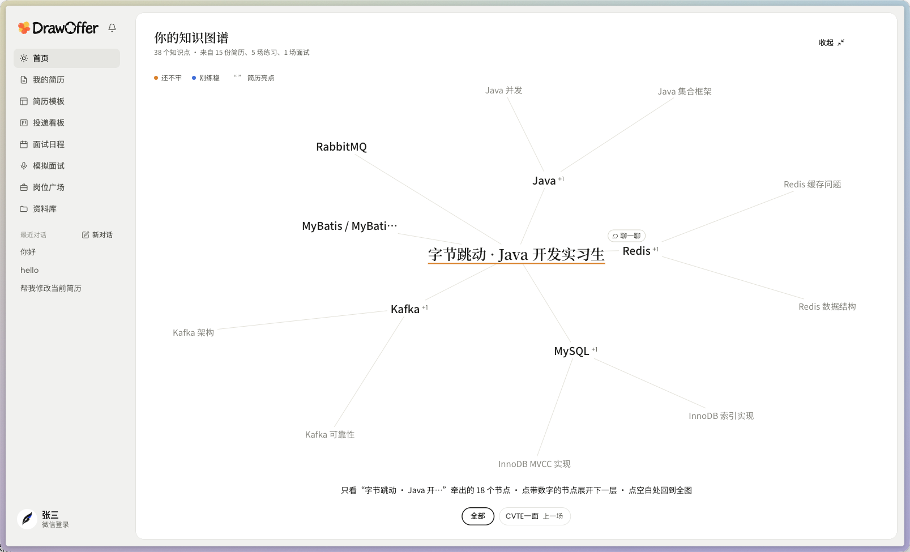
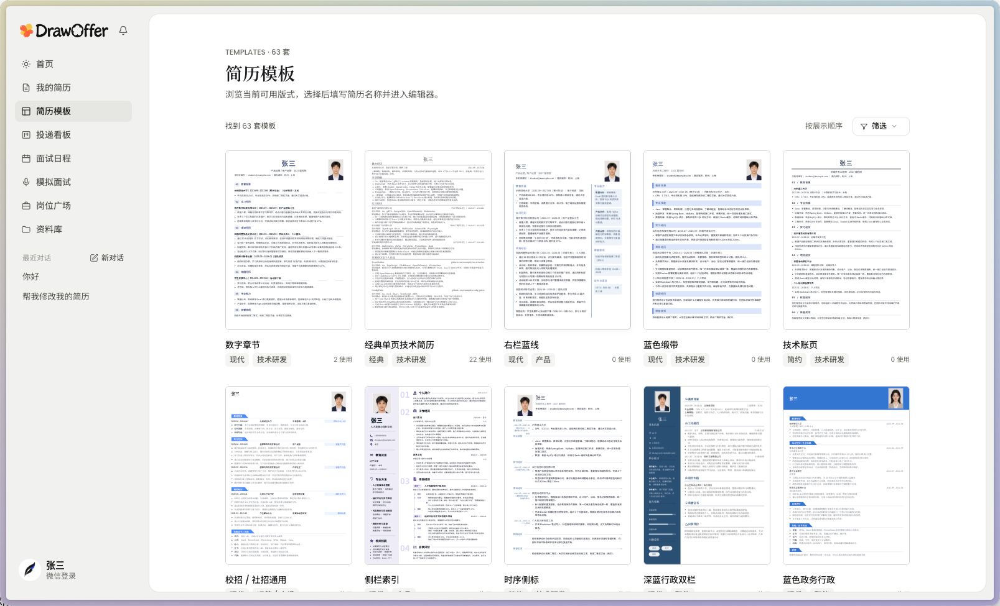

# DrawOffer

**The job-search partner that knows your story**

Resume edits, application tracking, interview reviews and mock follow-up questions — all based on your real experience, not a generic template. 
This repository hosts the **native macOS and Windows desktop clients** of DrawOffer.

[Website](https://www.drawoffer.com) · [Use online](https://www.drawoffer.com/assistant) · [中文](README.md) · [Issues](https://github.com/DrawOffer/drawoffer/issues)

## Why DrawOffer

Most resume tools only care about one resume, and most mock interview tools only care about one interview. A job search lasts months: which roles you applied to, which interview question tripped you up, which project is your strongest story. That context is scattered, so every AI tool has to learn about you from scratch.

DrawOffer keeps your resumes, applications, interview schedule and reviews as a **long-term memory of your job search**. When the AI edits your resume it knows the role you are targeting; when it writes interview questions it knows where you struggled last time.

The desktop apps rebuild the main features of the web app with native system controls, and share the same account and data with the web app and the WeChat mini program.

## Features

### 🧠 Knowledge graph that remembers every interview

Every topic you are asked in mock and real interviews goes into your knowledge graph, linked to your resume highlights and target roles. See at a glance what is still shaky and what you have mastered; focus on one company or role to see only what it will test.

<table>
<tr>
<td width="50%"></td>
<td width="50%"></td>
</tr>
</table>

### 🏠 Home: what you practiced, what to do next

### 📝 Resume templates and editor

60+ Chinese resume templates filtered by role and style; a WYSIWYG resume page rendered by the same engine as the web app and PDF export; import Markdown / Word / PDF, switch templates, export PDF and share links.

### 💼 Save the right jobs as you browse

Save postings from job sites with requirements organized for you, let AI tell you which roles fit your experience best, and track every application and interview on a board and calendar.

### 🎙 AI mock interviews and reviews

Questions based on the target role and your own experience; answer by text or voice; pauses and filler words are tracked and a review report is generated. On macOS 26+ speech is transcribed on device.

### 📚 Library and AI chat

Upload interview notes and project documents for the AI to reference, and chat with an assistant that knows your job-search history.

## Platform support

| Feature | macOS | Windows |
| --- | :---: | :---: |
| Home & knowledge graph | ✅ | ✅ |
| Resume editor | ✅ | Read-only preview |
| Resume templates | ✅ | ✅ |
| Job board & interview schedule | ✅ | ✅ |
| AI mock interview (text / voice) | ✅ | ✅ |
| On-device speech recognition | ✅ macOS 26+ | — |
| Library | ✅ | ✅ |
| AI chat | ✅ | ✅ |

Minimum OS: macOS 14 Sonoma, Windows 10 1809.

## Download

Installers are on the way and will be published under [Releases](https://github.com/DrawOffer/drawoffer/releases). Meanwhile you can use the web app at [www.drawoffer.com](https://www.drawoffer.com); your account and data work across both.

## Development

This repository contains only the desktop clients. The backend and web app live in a private repository referenced as the `upstream/` submodule, so outside contributors can read the client source but cannot build it end to end. See [CLAUDE.md](CLAUDE.md) for the layout and the web-to-desktop sync workflow.

## Related projects

- [drawoffer-mcp](https://github.com/DrawOffer/drawoffer-mcp) — let Claude, Cursor and other AI tools read and update your DrawOffer data
- [drawoffer-skills](https://github.com/DrawOffer/drawoffer-skills) — resume and job-search Agent Skills
- [drawoffer-prompts](https://github.com/DrawOffer/drawoffer-prompts) — job-search prompt library
- [drawoffer-chinese-resume-templates](https://github.com/DrawOffer/drawoffer-chinese-resume-templates) — Chinese resume templates

---

© DrawOffer. All rights reserved.
