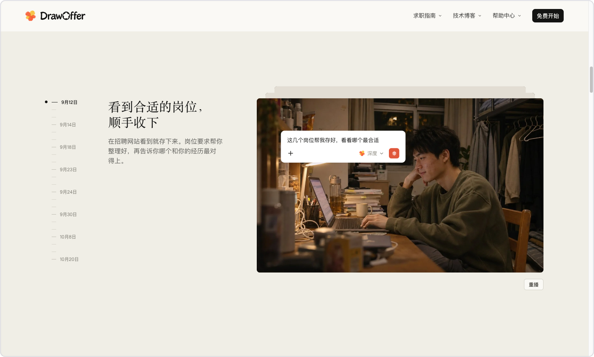
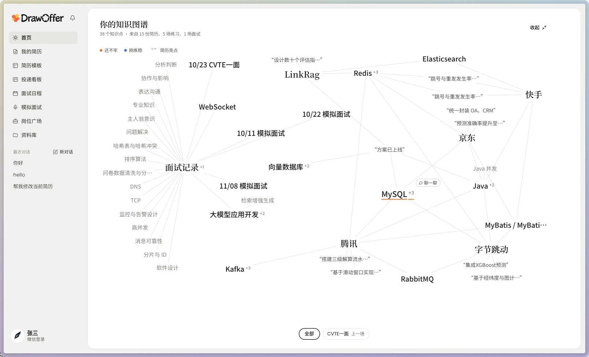
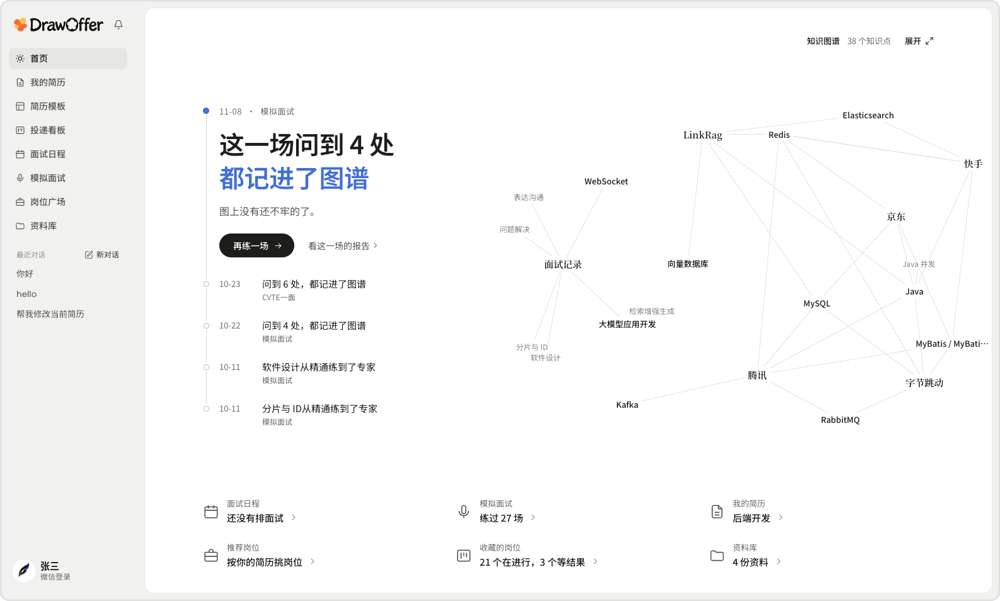
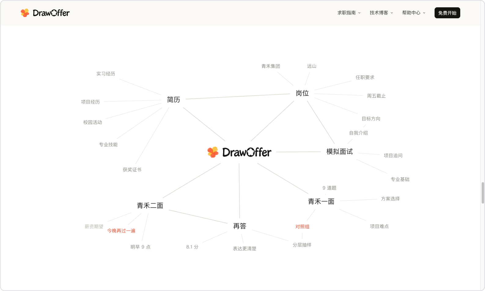

<h1>DrawOffer</h1>

<b>The job-search partner that knows your story</b>

Resume edits, application tracking, interview reviews and mock follow-up questions — all based on your real experience, not a generic template.

<a href="https://www.drawoffer.com">Website</a> ·
<a href="https://www.drawoffer.com/assistant">Use online</a> ·
<a href="#-download">Download</a> ·
<a href="https://github.com/DrawOffer/drawoffer/issues">Issues</a> ·
<a href="README.md">简体中文</a>

DrawOffer is an AI job-search partner for students and job seekers. It keeps your resumes, applications, practice sessions and every real interview in a **long-term memory**: when it edits your resume it knows the role you are applying for, when it writes questions it knows where you got stuck last time, and each interview picks up where the last one left off.

This repository hosts the **native macOS and Windows desktop clients**. They share the same account and data with the web app and the WeChat mini program. The product is currently in Chinese.

**[🚀 Start free](https://www.drawoffer.com/assistant)** · **[📦 Download](#-download)** · **[⭐ Star us](https://github.com/DrawOffer/drawoffer/stargazers)**

<table>
<tr>
<td width="50%" valign="top"><b>🧠 No need to start over</b> Tonight continues from last night, the next interview from this one. No re-pasting your resume or re-telling the last interview.</td>
<td width="50%" valign="top"><b>🎯 One resume, one role</b> Rewrite every section against the job description using only what you actually did. You approve every change.</td>
</tr>
<tr>
<td width="50%" valign="top"><b>🔍 Written vs. answered</b> What your resume says is your claim; what you answer in interviews is what counts. If it has never been asked, DrawOffer says it does not know yet.</td>
<td width="50%" valign="top"><b>🔒 You decide</b> You review every edit. Every memory shows its source and can be edited or deleted.</td>
</tr>
</table>

## 📅 From a job posting to an offer

### `Sep 12` Save the right job as you browse

Save postings from job sites. Requirements are organized for you, and DrawOffer tells you which role fits your experience best.

### `Sep 14` One resume for one role

Tailor each section to the job description with only what you really did. 60+ Chinese templates filtered by role; the page you see is exactly the PDF you send.

### `Sep 18` Every application accounted for

Screening, assessments, written tests, interviews: where each company stands and what comes next, on one board and one calendar.

### `Sep 23` Interview tomorrow — practice tonight

Questions based on this role and your resume, answered by text or voice. You will know which parts you still cannot explain clearly.

### `Sep 24` The night after, see what went wrong

Upload the recording and review it question by question. Every topic you were asked goes into your knowledge graph.

<table>
<tr>
<td width="50%"></td>
<td width="50%"></td>
</tr>
</table>

### `Sep 30` Answer the hard question again

Mock interviews start where you got stuck. Try the same question again and see if it is clear this time.

### `Oct 20` Got offers — now choose well

Compare offers side by side. Your records stay, so your next job search continues from here.

## 🖥 Platforms

| | macOS | Windows |
| --- | :---: | :---: |
| Home & knowledge graph | ✅ | ✅ |
| Resume templates | ✅ | ✅ |
| Resume editor | ✅ | Read-only preview |
| Job board & interview calendar | ✅ | ✅ |
| AI mock interview (text / voice) | ✅ | ✅ |
| On-device speech recognition | ✅ macOS 26+ | — |
| Library & AI chat | ✅ | ✅ |
| Minimum OS | macOS 14 Sonoma | Windows 10 1809 |

## 📦 Download

Installers are on the way and will be published under [Releases](https://github.com/DrawOffer/drawoffer/releases). Meanwhile, **[use the web app](https://www.drawoffer.com/assistant)** — your account and data work across both.

## 🛠 Development

This repository contains only the desktop clients. The backend and web app live in a private repository referenced as the `upstream/` submodule, so you can read the client source but a full build requires team access. See [CLAUDE.md](CLAUDE.md).

## 🧩 Ecosystem

- [drawoffer-mcp](https://github.com/DrawOffer/drawoffer-mcp) — let Claude, Cursor and other AI tools read and update your job-search data
- [drawoffer-skills](https://github.com/DrawOffer/drawoffer-skills) — resume and job-search Agent Skills
- [drawoffer-prompts](https://github.com/DrawOffer/drawoffer-prompts) — job-search prompt library
- [drawoffer-chinese-resume-templates](https://github.com/DrawOffer/drawoffer-chinese-resume-templates) — Chinese resume templates

<a href="#readme-top">⬆ Back to top</a>

---

© DrawOffer · All rights reserved

