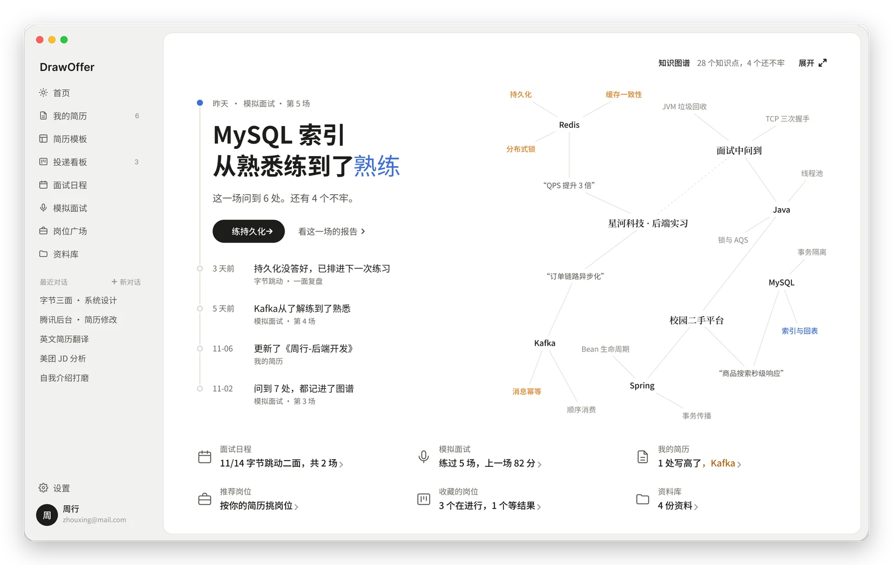
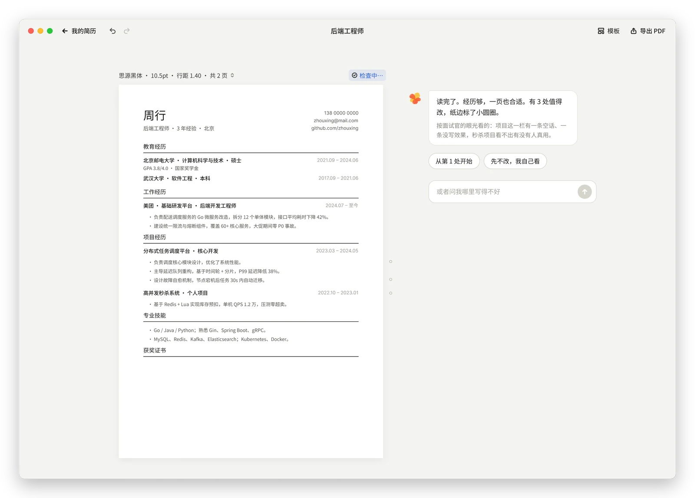
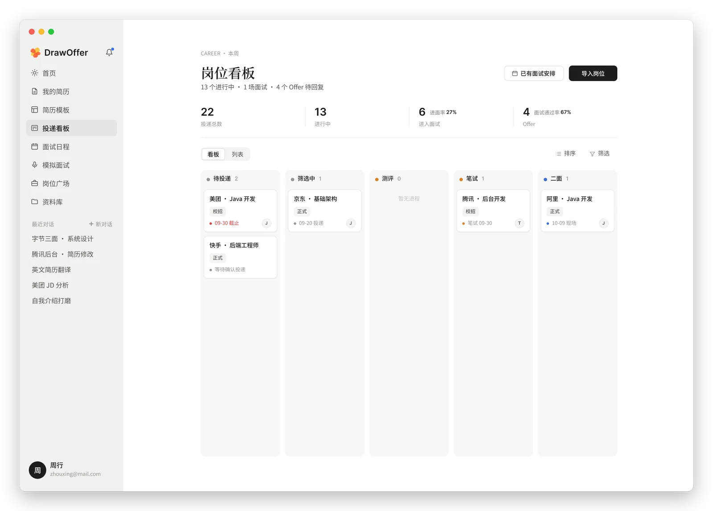
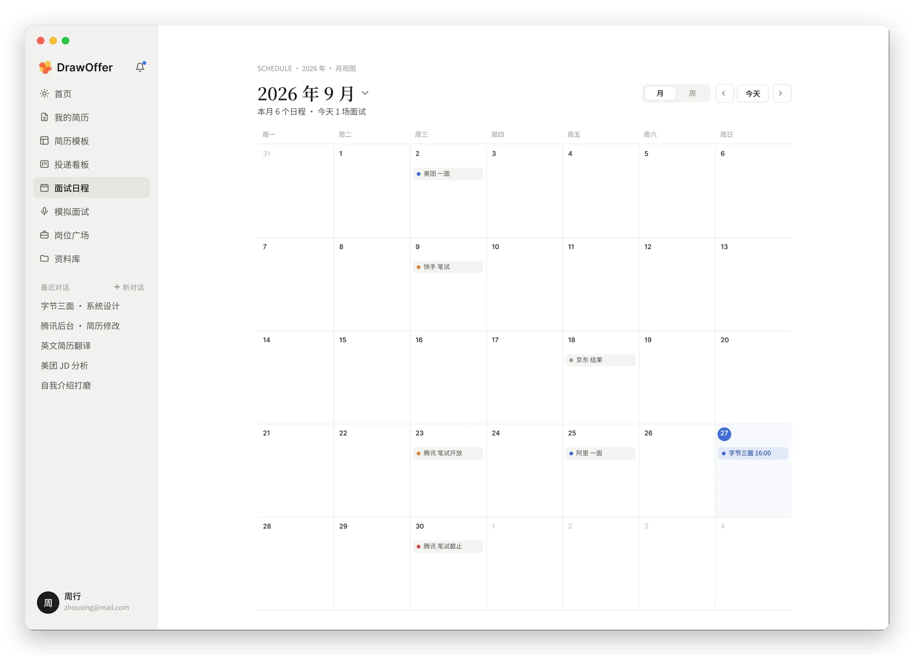
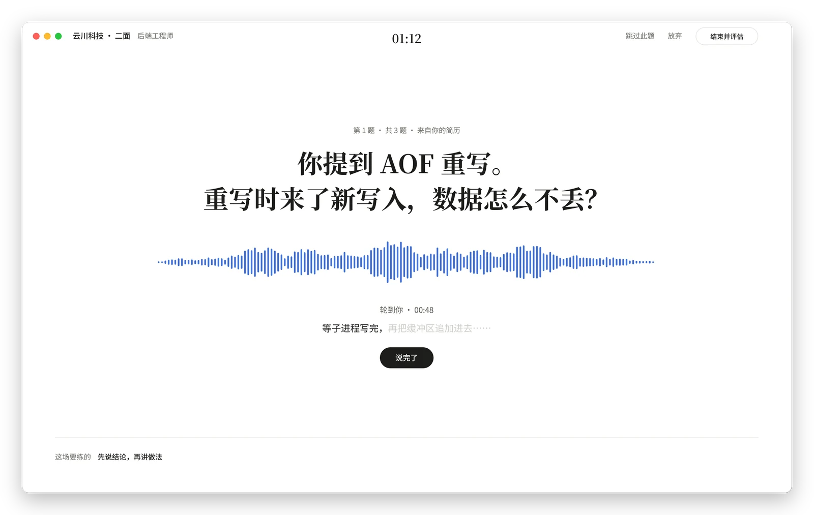
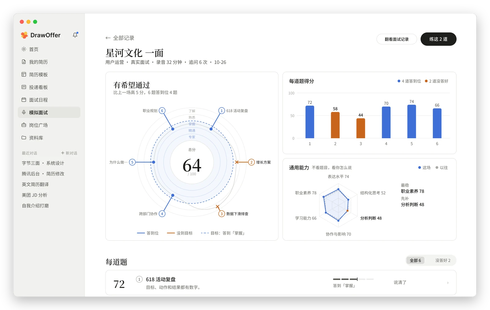
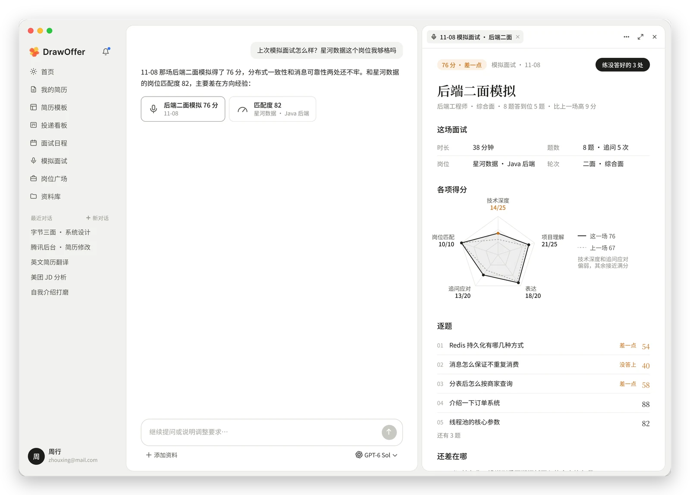
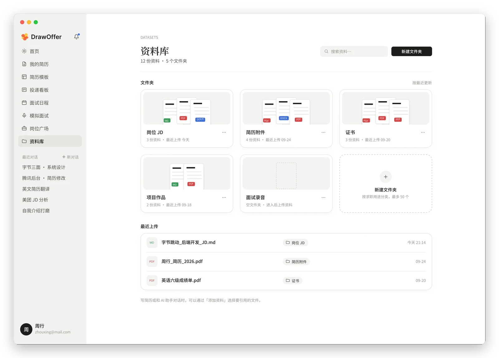

<a name="readme-top"></a>

<div align="center">

<a href="https://www.drawoffer.com"></a>

<h1>DrawOffer 职绘</h1>

<p><b>懂你经历的求职搭档</b></p>

<p>改简历、跟进投递、复盘面试、模拟追问，<br>都基于你自己的真实经历，而不是一份通用模板。</p>

<p>
<a href="https://www.drawoffer.com">官网</a> ·
<a href="https://www.drawoffer.com/assistant">在线使用</a> ·
<a href="#-下载">下载桌面版</a> ·
<a href="https://github.com/DrawOffer/drawoffer/issues">问题反馈</a> ·
<a href="README.en.md">English</a>
</p>

[](#-平台支持)
[](#-平台支持)
[](apps/mac)
[](apps/windows)<br>
[](https://www.drawoffer.com)
[](https://github.com/DrawOffer/drawoffer/stargazers)
[](https://github.com/DrawOffer/drawoffer/commits/master)



</div>

DrawOffer 是面向应届生和求职者的 AI 求职搭档。它把你的简历、投递、练习和面过的每一场都存进**长期记忆**：改简历时知道你投的是哪个岗位，出题时知道你上次卡在哪里，下一场面试接着上一场往前走。

本仓库是 DrawOffer 的 **macOS / Windows 原生桌面客户端**，与网页版、微信小程序共用同一个账号和数据。

**[🚀 免费开始](https://www.drawoffer.com/assistant)** · **[📦 下载桌面版](#-下载)** · **[⭐ 给个 Star](https://github.com/DrawOffer/drawoffer/stargazers)**

<table>
<tr>
<td width="50%" valign="top">
<b>🧠 你不用从头说起</b><br>
今晚接着昨晚，下一场接着这一场。不用再贴一遍简历，也不用再讲一遍上次面了什么。
</td>
<td width="50%" valign="top">
<b>🎯 一份简历，对上一个岗位</b><br>
对着 JD 改写每一段，只用你真实做过的事。每处修改都由你确认。
</td>
</tr>
<tr>
<td width="50%" valign="top">
<b>🔍 写过和答过，它分得清</b><br>
简历上写的是你的说法，面试里答出来的才算数。没问过的，它会说还不知道。
</td>
<td width="50%" valign="top">
<b>🔒 最后由你决定</b><br>
每处修改你先看。每条记忆都能查来源，也能改、能删，数据存放在境内。
</td>
</tr>
</table>

## ✨ 功能

### 🏠 首页与长期记忆

打开就能看到最近一次练习练到了哪、哪些知识点还不牢，以及下一步该做什么。每一场练习和面试问到的点都会记进**知识图谱**，标出还不牢和刚练稳的。

- 🧠 知识图谱串起简历、岗位、练习和真实面试里出现过的每个知识点
- 📌 最近进展按时间排开，每条都能直接点进去接着练
- 🗂 面试日程、投递、简历、资料库各给一句话现状和入口

### 📝 简历：边看纸面边改



- ✍️ 原生编辑器所见即所得，纸面与 PDF 导出用同一个渲染器，看到的就是投出去的
- 🔎 「检查简历」按面试官的眼光读一遍，在纸边标出值得改的地方，逐处确认后才写入
- 🎨 60+ 套中文模板按岗位方向筛选，换模板不用重新排版
- 📥 导入 Markdown / Word / PDF 简历，导出 PDF、生成分享链接

### 📌 投递与面试日程

<table>
<tr>
<td width="50%"></td>
<td width="50%"></td>
</tr>
<tr>
<td align="center"><sub><b>投递看板</b> · 每家走到哪一步，一眼看清</sub></td>
<td align="center"><sub><b>面试日程</b> · 笔试、面试按日历排开，不撞车</sub></td>
</tr>
</table>

- 📋 投递、测评、笔试、面试、Offer，每个岗位的阶段和下一步都在一张看板上
- 🎯 岗位匹配度告诉你哪个岗位和你的经历最对得上

### 🎙 模拟面试与复盘

<table>
<tr>
<td width="50%"></td>
<td width="50%"></td>
</tr>
<tr>
<td align="center"><sub><b>模拟面试</b> · 按岗位和你的简历出题、追问</sub></td>
<td align="center"><sub><b>复盘报告</b> · 每道题答到哪一层、通用能力怎么样</sub></td>
</tr>
</table>

- 🗣 文字或语音作答，项目追问、专业基础、自我介绍都会练到
- 📊 结束后生成复盘报告：每道题得分、没答好的原因，和上一场比进步了多少
- 🎧 真实面试也能传录音复盘，被问到的知识点自动记进图谱
- 💻 macOS 26 起语音作答在本机离线转写，不经过云端识别

### 💬 AI 对话与资料库

<table>
<tr>
<td width="50%"></td>
<td width="50%"></td>
</tr>
<tr>
<td align="center"><sub><b>AI 对话</b> · “明天二面今晚该补什么？”直接问</sub></td>
<td align="center"><sub><b>资料库</b> · 面经、笔记、项目文档，出题和改简历都会参考</sub></td>
</tr>
</table>

<div align="right"><a href="#readme-top">⬆ 回到顶部</a></div>

## 🖥 平台支持

| | macOS | Windows |
| --- | :---: | :---: |
| 首页与知识图谱 | ✅ | ✅ |
| 简历模板 | ✅ | ✅ |
| 简历编辑 | ✅ | 只读预览 |
| 投递看板与面试日程 | ✅ | ✅ |
| AI 模拟面试（文字 / 语音） | ✅ | ✅ |
| 本机语音识别 | ✅ macOS 26+ | — |
| 资料库与 AI 对话 | ✅ | ✅ |
| 最低系统 | macOS 14 Sonoma | Windows 10 1809 |

## 📦 下载

安装包正在准备中，发布后会出现在 [Releases](https://github.com/DrawOffer/drawoffer/releases)。现在可以先 **[在线使用网页版](https://www.drawoffer.com/assistant)**，账号和数据与桌面版互通。

> [!TIP]
> 点击右上角 **Watch → Custom → Releases**，桌面版发布时第一时间收到通知。

## 🗺 路线图

- [x] macOS 原生客户端：首页、简历、模板、投递看板、面试日程、模拟面试、资料库、AI 对话
- [x] macOS 26 本机语音识别
- [ ] 发布 macOS 与 Windows 安装包
- [ ] Windows 简历编辑
- [ ] macOS 14–25 本机语音识别（SenseVoice）

## ❓ 常见问题

<details>
<summary><b>DrawOffer 和普通的 AI 简历工具有什么不同？</b></summary>
<br>
普通工具每次只看眼前这一份简历。DrawOffer 记得你投过的岗位、练过和面过的题、简历里的亮点，并把它们连成知识图谱。所以它改简历只用你真实做过的事，出题从你上次卡住的地方开始，也能告诉你哪些知识点还不牢。
</details>

<details>
<summary><b>桌面版和网页版有什么区别？</b></summary>
<br>
主要功能相同，账号和数据互通。桌面版使用系统原生界面；macOS 版从 macOS 26 起支持本机语音转写。Windows 版部分功能仍在补齐。
</details>

<details>
<summary><b>我的简历、面试录音和记忆安全吗？</b></summary>
<br>
客户端通过 HTTPS 访问 DrawOffer 服务，登录凭据保存在系统钥匙串（macOS Keychain / Windows Credential Locker）。每条记忆都能查来源、修改和删除，数据存放在境内。使用本机语音识别时，转写在你的电脑上完成。
</details>

<details>
<summary><b>怎么收费？</b></summary>
<br>
可以免费开始使用，AI 功能按积分计费，套餐与价格以官网为准。
</details>

## 🧩 生态

| 项目 | 说明 |
| --- | --- |
| [DrawOffer 网页版](https://www.drawoffer.com) | 完整功能的在线版本 |
| [drawoffer-mcp](https://github.com/DrawOffer/drawoffer-mcp) | 让 Claude、Cursor 等 AI 工具读写你的求职数据 |
| [drawoffer-skills](https://github.com/DrawOffer/drawoffer-skills) | 简历与求职 Agent Skills |
| [drawoffer-prompts](https://github.com/DrawOffer/drawoffer-prompts) | 简历诊断、JD 匹配、STAR 改写等求职提示词 |
| [drawoffer-chinese-resume-templates](https://github.com/DrawOffer/drawoffer-chinese-resume-templates) | 中文简历模板库 |

## 🛠 开发

```text
apps/mac       macOS 客户端（SwiftUI，Swift Package：Core / Render / App）
apps/windows   Windows 客户端（WinUI 3，.NET）
apps/native    两端共用：简历纸面渲染器、共享素材、检查脚本
apps/desktop   早期 Electron 壳（已被原生客户端取代）
```

```bash
git clone --recurse-submodules https://github.com/DrawOffer/drawoffer.git
cd drawoffer/apps/mac && swift build      # macOS
apps/windows/scripts/typecheck.sh         # Windows 类型检查
```

后端与 Web 端位于私有仓库，以子模块 `upstream/` 引用：可以阅读客户端源码，完整构建需要团队权限。客户端跟随 Web 端迭代，流程见 [CLAUDE.md](CLAUDE.md)。

## 🤝 反馈

遇到问题或有想法，欢迎[提交 Issue](https://github.com/DrawOffer/drawoffer/issues)。如果 DrawOffer 帮到了你的求职，点一个 ⭐ Star，让更多同学看到它。

<a href="https://star-history.com/#DrawOffer/drawoffer&Date">
  <picture>
    <source media="(prefers-color-scheme: dark)" srcset="https://api.star-history.com/svg?repos=DrawOffer/drawoffer&type=Date&theme=dark">
    
  </picture>
</a>

<div align="right"><a href="#readme-top">⬆ 回到顶部</a></div>

---

<div align="center"><sub>© DrawOffer · All rights reserved</sub></div>
